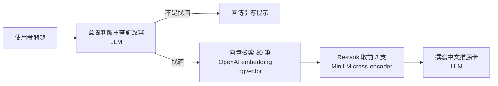

# Whiskey Assistant

你的貼身侍酒師：不用背產區，也不用懂行話，說一句「想喝有巧克力和橘子皮的」，它就翻遍一萬四千多篇真實品飲筆記，挑出三支端到你面前，再用中文告訴你聞起來、喝起來、喝完是什麼感覺。唯一的缺點是，它不會幫你買單。

**線上試用：<https://whisky-assistant.vercel.app>**

## 特色

- **描述想喝的酒**：簡單的風味（「有沒有喝起來像巧克力、橘子皮的？」）或較專業的條件（「想找雪莉桶熟成、帶一點泥煤煙燻，有黑巧克力和皮革調性的」）都可以
- **查指定酒款**：輸入酒名（「Macallan 18 喝起來如何？」），找出該酒款與相近版本的品飲筆記並整理成風味介紹
- **點選風味標籤**：不知道怎麼描述時，點選蜂蜜、果乾、泥煤、皮革等標籤，自動組成問句
- **介紹來自真實品飲筆記**：每支酒附上一句話印象，以及香氣、口感、尾韻三段描述。內容只根據品飲者的筆記改寫，不由 LLM 憑空編造
- **只回答找酒的問題**：無關的問題不會硬推薦，而是引導使用者描述想要的風味

## 運作方式

1. **意圖判斷與查詢改寫**：一次 LLM 呼叫同時判斷是否在找酒，並把中文問題改寫成英文品飲筆記的口吻，讓查詢和英文筆記的寫法一致
2. **向量檢索**：用 OpenAI `text-embedding-3-small` 把查詢轉成向量，從 pgvector 取出最相近的 30 筆候選
3. **Re-rank**：cross-encoder 把查詢和每篇筆記成對讀入、逐篇評分，挑出最符合的 3 支
4. **撰寫推薦卡**：LLM 依筆記內容寫成中文介紹，以 Structured Outputs 取得固定格式；酒名一律由資料庫對回，避免被改寫或寫錯
- **兩階段檢索**：向量檢索負責「不漏掉」，cross-encoder re-rank 負責「排得準」
- **依部署成本調整模型**：原本在本機執行的 `bge-m3` 與 `bge-reranker-v2-m3` 常駐記憶體約 4 到 6 GB；改用 embedding API 與小型 reranker 後降到 1 GB 以下，並以同一組題目確認準確度沒有下降（83% → 87%）
- **降低 prompt injection 影響**：使用者輸入以標記包起來並視為資料；LLM 只能輸出固定欄位

## 技術棧

| 項目 | 選擇 |
|---|---|
| 後端 | Python 3.12、FastAPI |
| 資料庫 | PostgreSQL 17 ＋ pgvector（HNSW 索引） |
| Embedding | OpenAI `text-embedding-3-small` |
| Re-rank | `cross-encoder/ms-marco-MiniLM-L-6-v2`（本機執行，約 90 MB） |
| LLM | OpenAI Responses API（Structured Outputs） |
| 前端 | Vue 3、Vite、TypeScript |
| 部署 | 前端 Vercel；後端與資料庫 Railway |

## 已知限制與後續規劃

- 一次回答約需 20 秒（兩次 LLM 呼叫，主要花在撰寫推薦卡），之後考慮以串流逐張顯示
- 單純否定的需求（「完全沒有煙燻味」）仍可能推薦出煙燻酒
- 查詢改寫會把描述轉成常見的風味詞，不同問題容易推薦到少數相同酒款
- 後續規劃：建立評估集量化檢索品質、加入多輪對話

完整規格與待決定事項見 [SPEC.md](SPEC.md)。
