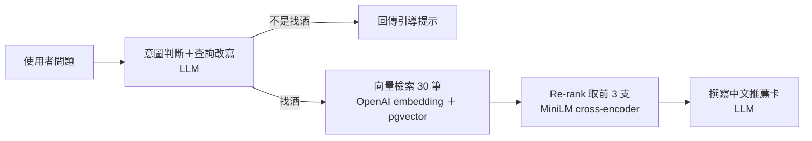

# Whiskey Assistant

你的貼身侍酒師：不用背產區，也不用懂行話，說一句「想喝有巧克力和橘子皮的」，它就翻遍一萬四千多篇真實品飲筆記，挑出三支端到你面前，再用中文告訴你聞起來、喝起來、喝完是什麼感覺。唯一的缺點是，它不會幫你買單。

**線上試用：<https://whisky-assistant.vercel.app>**

## 特色

- **描述想喝的酒**：從「像巧克力、橘子皮的」到「雪莉桶熟成、帶一點泥煤煙燻」都可以
- **查指定酒款**：輸入酒名（如「Macallan 18 喝起來如何？」），整理出該酒款與相近版本的風味
- **點選風味標籤**：不知道怎麼描述時，點選蜂蜜、泥煤、皮革等標籤組成問句
- **介紹來自真實筆記**：一句話印象加上香氣、口感、尾韻，只根據品飲筆記改寫，不憑空編造
- **只回答找酒的問題**：無關的問題不硬推薦，改為引導描述風味

## 運作方式

1. **意圖判斷與查詢改寫**：判斷是否在找酒，並把問題改寫成英文品飲筆記的口吻
2. **向量檢索**：用 OpenAI embedding 從 pgvector 取出 30 筆候選，負責「不漏掉」
3. **Re-rank**：cross-encoder 逐篇評分，挑出最符合的 3 支，負責「排得準」
4. **撰寫推薦卡**：LLM 依筆記寫成中文介紹，以 Structured Outputs 固定格式；

## 技術棧

| 項目 | 選擇 |
|---|---|
| 後端 | Python 3.12、FastAPI |
| 資料庫 | PostgreSQL 17 ＋ pgvector（HNSW 索引） |
| Embedding | OpenAI `text-embedding-3-small` |
| Re-rank | `cross-encoder/ms-marco-MiniLM-L-6-v2` |
| LLM | OpenAI API |
| 前端 | Vue 3、Vite、TypeScript |
| 部署 | 前端 Vercel；後端與資料庫 Railway |

## 已知限制與後續規劃

- 一次回答約需 20 秒，之後考慮以串流逐張顯示
- 單純否定的需求（「完全沒有煙燻味」）仍可能推薦出煙燻酒
- 查詢改寫會把描述轉成常見的風味詞，不同問題容易推薦到少數相同酒款
- 後續規劃：建立評估集量化檢索品質、加入多輪對話

完整規格與待決定事項見 [SPEC.md](SPEC.md)。
